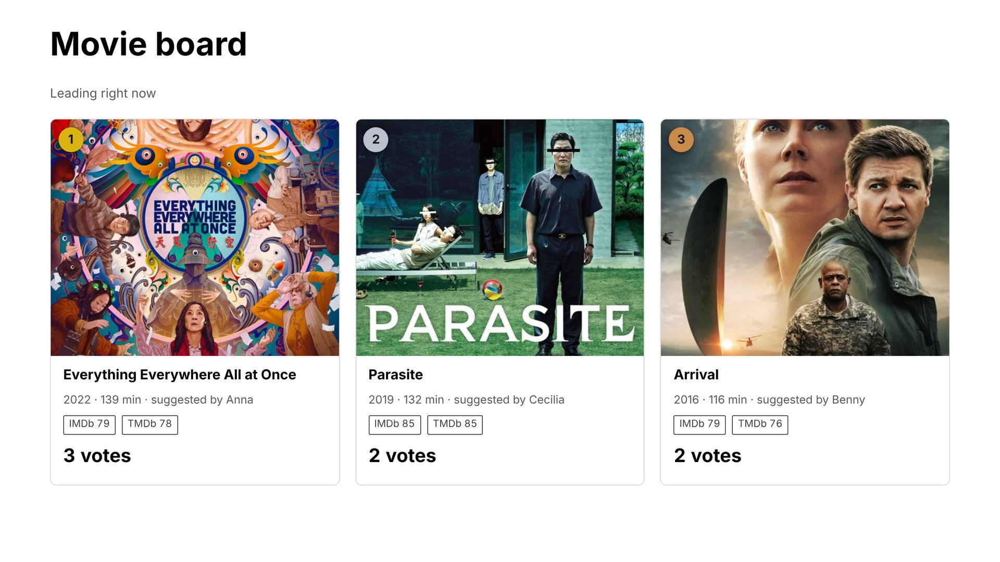
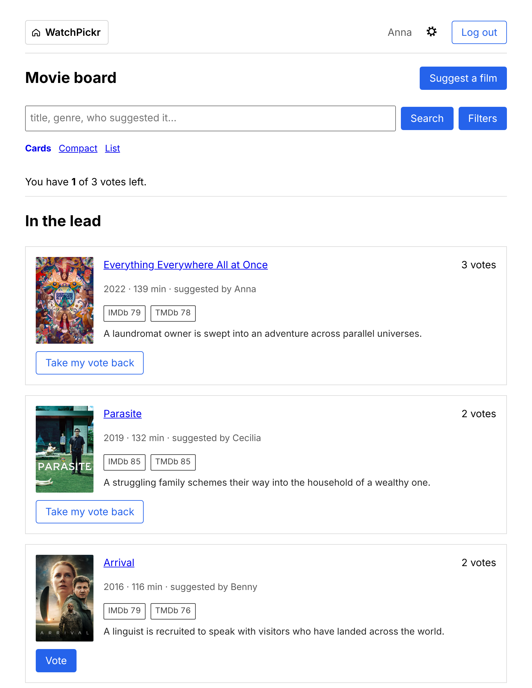
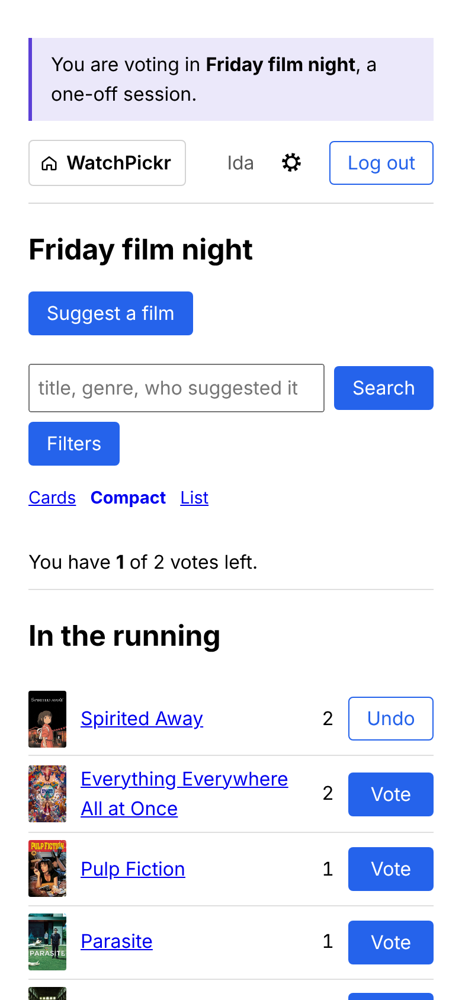
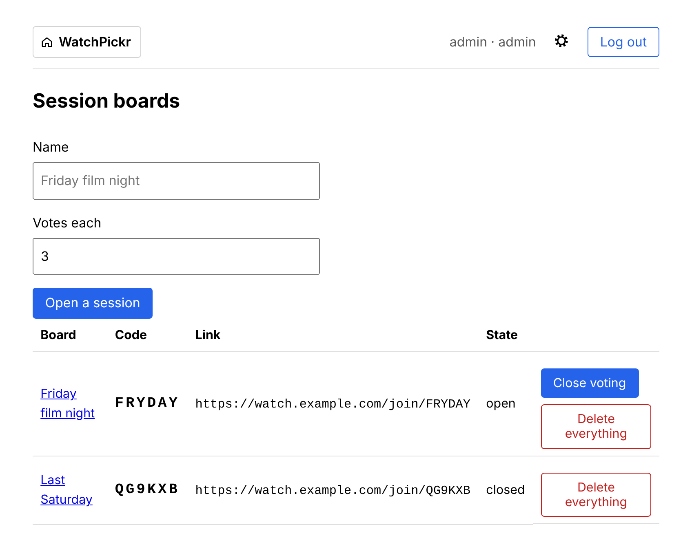

# WatchPickr

A self-hosted voting board for picking what to watch next. Everyone gets a few
votes, anyone can suggest a movie or series by pasting an IMDb link, and the top
three end up on a podium.

It's a single Go binary with a SQLite database.

<picture>
  <source media="(prefers-color-scheme: dark)"
    srcset="docs/screenshots/podium-dark.jpg">
  
</picture>

## Try it

```sh
git clone https://github.com/hearthservices/watchpickr
cd watchpickr
docker compose up demo
```

Then open <http://localhost:8081> and log in as `admin`, `Anna`, `Benny`,
`Cecilia` or `David`. The password is `watchpickr` for all of them. The demo has
some films and votes, one film already watched, and an open session you can
join with the code `FRYDAY`. It runs on a temporary database that is deleted
when the demo stops, and it never touches a configured one. Its posters are
downloaded from TMDb when it starts.

Without Docker: `go run ./cmd/watchpickr -demo`, on port 8080.

## Features

- Everyone has a number of votes, set by the admin. When they're used up you
  have to take one back to vote for something else.
- Paste an IMDb link and the title, year, runtime, synopsis, poster and ratings
  are filled in.
- Series can be suggested too, unless the admin turns that off.
- Marking a film as watched gives its voters their votes back, and keeps a
  record of who voted for it. Other boards get a note about it, but it stays in
  their running.
- `/podium` shows the top three full screen without logging in, so it can go on
  a TV. If you're logged in you can vote from there too, and on a session's
  podium an admin can mark what was watched.
- Session boards for one-off evenings. Guests join with a code and vote
  separately from the regular board, using the same film list. What a guest
  suggests stays in their session.
- Votes show up for everyone right away. Everything also works with JavaScript
  turned off.

## Screenshots

The board, and a guest voting in a session from their phone:

<p>
  <picture>
    <source media="(prefers-color-scheme: dark)"
      srcset="docs/screenshots/board-dark.png">
    
  </picture>
  <picture>
    <source media="(prefers-color-scheme: dark)"
      srcset="docs/screenshots/phone-dark.png">
    
  </picture>
</p>

Session boards, each with its own join code:

<picture>
  <source media="(prefers-color-scheme: dark)"
    srcset="docs/screenshots/sessions-dark.png">
  
</picture>

## Running it

```sh
git clone https://github.com/hearthservices/watchpickr
cd watchpickr
docker compose up -d
```

Unless you set `WATCHPICKR_ADMIN_PASSWORD`, an admin password is generated on
the first start and printed to the log once:

```sh
docker compose logs watchpickr | grep "generated an admin password"
```

### Configuration

These are environment variables. The number of votes and whether series are
allowed are set on the admin page instead.

| Variable                       | Default                   | What it does                       |
| ------------------------------ | ------------------------- | ---------------------------------- |
| `WATCHPICKR_ADDR`              | `:8080`                   | listen address                     |
| `WATCHPICKR_DB`                | `data/watchpickr.db`      | SQLite file                        |
| `WATCHPICKR_POSTER_DIR`        | `data/posters`            | cached poster images               |
| `WATCHPICKR_SITE_NAME`         | `WatchPickr`              | name in the header                 |
| `WATCHPICKR_SECURE_COOKIES`    | `false`                   | set once you have HTTPS in front   |
| `WATCHPICKR_SESSION_DAYS`      | `30`                      | how long a login lasts             |
| `WATCHPICKR_ADMIN_USERNAME`    | `admin`                   | bootstrap admin name               |
| `WATCHPICKR_ADMIN_PASSWORD`    | generated                 | applied on every start when set    |
| `WATCHPICKR_REGISTRATION_CODE` | none                      | require an invite code to sign up  |
| `WATCHPICKR_TRUSTED_PROXIES`   | loopback + private ranges | whose `X-Forwarded-For` to believe |
| `TMDB_API_KEY`                 | none                      | posters, synopses, ratings         |
| `OMDB_API_KEY`                 | none                      | extra ratings                      |
| `WATCHPICKR_DEMO`              | `false`                   | same as `-demo`                    |

`WATCHPICKR_SECURE_COOKIES` needs HTTPS. If it's on over plain http, the browser
never sends the login cookie and logging in just doesn't work.

### API keys

Both are optional. Without them you type in titles yourself, and there are no
posters or ratings.

- TMDb, free with no daily limit: <https://www.themoviedb.org/settings/api>
- OMDb, free for 1000 requests a day, adds Metacritic and Rotten Tomatoes
  scores. The key has to be activated from the link in the signup email first:
  <https://www.omdbapi.com/apikey.aspx>

## Development

```sh
make run    # go run
make demo   # Throwaway instance with demo data
make test   # go test -race ./...
make lint   # gofmt -l and go vet
make build  # Static binary in dist/
```

## Credits

This product uses the TMDb API but is not endorsed or certified by TMDb.
Ratings also come from OMDb.

Inspired by [cinevote](https://github.com/o5ten/cinevote), a friend's take on
the same problem.

## License

MIT
